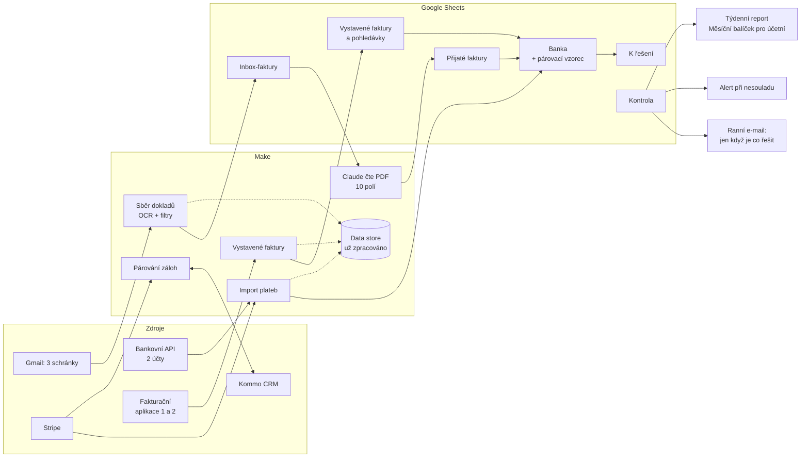

# Finanční agent v Make: manažerské účetnictví malé firmy bez ručního přepisování

Systém 27 scénářů v Make, který každou noc posbírá doklady ze tří e-mailových schránek, nechá Claude přečíst PDF, stáhne pohyby z banky, Stripe a dvou fakturačních aplikací a spáruje platby s fakturami. Ráno je v Google Sheets hotový přehled a do e-mailu přijde jen to, co potřebuje lidské rozhodnutí.

Běží v provozu ve vzdělávacím institutu (kurzy pro dospělé, cca 7 lidí v týmu). Denně s ním pracuje podpora studentů, obchodníci a externí účetní. Některé scénáře mají za sebou přes 550 spuštění.

> Repozitář je ukázka, jak je systém postavený. Všechny ID, e-maily, čísla účtů, tokeny, jména a názvy klientů jsou nahrazené zástupnými hodnotami (`YOUR_...`, `example.com`). Připojení (connections) se v Make vybírají až po importu, blueprint žádné přihlašovací údaje neobsahuje.

## Proč to vzniklo

Před automatizací to vypadalo takto: faktury chodily do tří schránek, část jako PDF, část jako e-mail bez přílohy (Apple, Google, Meta). Platby studentů přicházely přes banku i Stripe, zálohy se ručně dohledávaly v CRM. Na konci měsíce se účetní posílala složka, ve které vždycky něco chybělo.

Cíl nebyl „zautomatizovat všechno“. Cíl byl, aby člověk řešil jen výjimky.

## Architektura

## Vrstvy systému

**1. Sběr dokladů.** Gmail trigger hledá PDF přílohy se slovy faktura, invoice, receipt. PDF se nahraje do Google Drive s konverzí, tím vznikne textová vrstva (OCR), a dočasný soubor se hned smaže. Regulární výraz v textu hledá IČO firmy a typ dokladu. Faktura na firmu jde do složky měsíce, ostatní do složky `_neposílat`. E-maily bez přílohy (účtenky z Apple, Google, Meta) se převádějí celé do PDF.
Scénář: [`01_prijate_faktury_z_gmailu.json`](scenare/01_prijate_faktury_z_gmailu.json)

**2. Claude čte doklad.** Z listu Inbox-faktury se vezme max. 15 nezpracovaných řádků. Claude dostane PDF a vrátí jeden řádek s 10 poli oddělenými `|`: typ dokladu, dodavatel, číslo, VS, datumy, částka, měna, kategorie, poznámka. Router podle prvního pole rozhodne, jestli řádek patří do Přijatých faktur, nebo dostane důvod, proč ne.
Scénář: [`02_claude_cte_pdf.json`](scenare/02_claude_cte_pdf.json)

**3. Banka a párování.** Bankovní API (PSD2) vrací pohyby za poslední 3 dny. Každá transakce se zapíše jen jednou díky klíči v data store. Do listu Banka se zapíše řádek se vzorcem, který hledá doklad v kaskádě:
1. podle variabilního symbolu,
2. podle klíčového slova dodavatele + částky s tolerancí + okna data,
3. podle částky a data.

Výsledek se ukazuje jako `✔ VS`, `✔ dodavatel+částka`, `✔ částka+datum` nebo `CHYBÍ`. Účetní hned vidí, jak jistá je shoda.
Scénář: [`03_banka_import_a_parovani.json`](scenare/03_banka_import_a_parovani.json)

**4. Vystavené faktury.** Faktury z fakturačních aplikací se přes API zapisují do listu pohledávek. Pokud obchodník předem založil plánovaný řádek klienta, faktura se doplní do něj. Jinak vznikne nový řádek s poznámkou ke kontrole. Stav (Čeká, Zaplaceno, Po splatnosti, Přeplatek) počítá vzorec z listu Banka.
Scénář: [`04_vystavene_faktury_z_api.json`](scenare/04_vystavene_faktury_z_api.json)

**5. Zálohy: Stripe a CRM.** Po zaplacení zálohy přes Stripe webhook hledá lead v Kommo nejdřív podle e-mailu, potom podle jména. Jedna jistá shoda: lead se přesune do etapy „Záloha zaplacena“, vznikne poznámka a úkol „Připravit smlouvu“ s termínem 2 hodiny. Nejistá shoda: úkol začíná slovem OVĚŘIT. Žádná shoda: úkol najít lead ručně. Každá varianta zapíše řádek do tabulky Zálohy.
Scénář: [`05_zalohy_stripe_kommo.json`](scenare/05_zalohy_stripe_kommo.json)

**6. Kontrola a reporting.** List Kontrola hlídá zůstatky, čas posledního běhu každého zdroje a nesoulady. Alert přijde jen při stavu ALERT, v pondělí týdenní přehled, 1. v měsíci odkaz na složku pro účetní.
Scénář: [`06_kontrola_alert_a_tydenni_report.json`](scenare/06_kontrola_alert_a_tydenni_report.json)

**7. Provize.** Výplata obchodníka se v bance rozdělí na fixní část a provizi, aby report nákladů seděl.
Scénář: [`07_rozdeleni_platby_fix_a_provize.json`](scenare/07_rozdeleni_platby_fix_a_provize.json)

Kompletní seznam všech 27 scénářů je v [docs/katalog-scenaru.md](docs/katalog-scenaru.md), struktura tabulky v [docs/struktura-tabulky.md](docs/struktura-tabulky.md).

## Co jsem ladila a jak

Systém nevznikl na první pokus. Tohle jsou problémy, na které jsem v provozu narazila, a řešení, která fungují.

| Problém | Řešení |
|---|---|
| Duplicitní řádky, když scénář běžel znovu | Každý doklad a transakce dostane klíč v data store. `AddRecord` s `overwrite: false` při duplicitě selže a handler `Ignore` zastaví jen tento bundle. Opakovaný běh je bezpečný. |
| Claude odpovídal pokaždé jinak, výstup se nedal spolehlivě rozdělit | Pevný formát: jeden řádek, přesně 10 polí, prázdné pole = `-`, znak `\|` uvnitř pole zakázaný. Kategorie jen z daného seznamu. |
| Účtenky Apple, Google, Meta Claude označoval jako „jiný odběratel“ | Firemní pravidlo patří do kontextu: v promptu je výslovně, že tyto účtenky jsou firemní náklad, i když na nich není jméno firmy. |
| Přečerpané tokeny | Claude dostává jen doklady, které prošly levnými filtry (PDF, regulární výraz na OCR textu, deduplikace), a max. 15 za běh. |
| Propadlé připojení se nikde neprojevilo, data jen přestala přibývat | Každý zdrojový scénář zapisuje čas posledního běhu do listu Kontrola. Starý údaj spustí alert. |
| Výstup na špatném místě (doklad v jiném měsíci) | Složky měsíců zakládá zvláštní scénář dopředu a jejich ID ukládá do data store. Ostatní scénáře ID jen čtou, nic nehledají podle názvu. |
| Nejisté shody tiše prošly jako jisté | Každá shoda nese úroveň jistoty. Nejistá jde do listu K řešení nebo do úkolu OVĚŘIT, rozhoduje člověk. |
| EUR faktury zkreslovaly přehled v Kč | Částka v Kč je odhad podle kurzu z listu Kontrola a v poznámce je napsáno, že se má po platbě upravit. |

## Jak importovat do Make

1. V Make: **Create a new scenario → ⋯ → Import Blueprint** a vyberte JSON ze složky `scenare/`.
2. U každého modulu vyberte vlastní připojení (Google, Gmail, Claude, Kommo, Stripe, HTTP).
3. Nahraďte zástupné hodnoty `YOUR_...` (ID tabulky, složek, pipeline, etap), vytvořte data store `zpracovane_id` (klíč + pole `acc`) a `slozky_mesicu` (klíč + pole `id`).
4. Vytvořte tabulku podle [docs/struktura-tabulky.md](docs/struktura-tabulky.md).

## Technologie

Make (scénáře, router, data store, error handlery, HTTP), Claude API (čtení PDF), Google Sheets (LET, ARRAYFORMULA, REGEXMATCH), Google Drive (OCR přes konverzi), Gmail, Kommo CRM API v4, Stripe webhooks, bankovní API (PSD2 AISP), REST API fakturačních aplikací (API key, OAuth client credentials).

---

Autorka: Anna Kononova, lektorka AI a automatizace. Kód je zveřejněn jako ukázka práce, viz [LICENSE](LICENSE).
